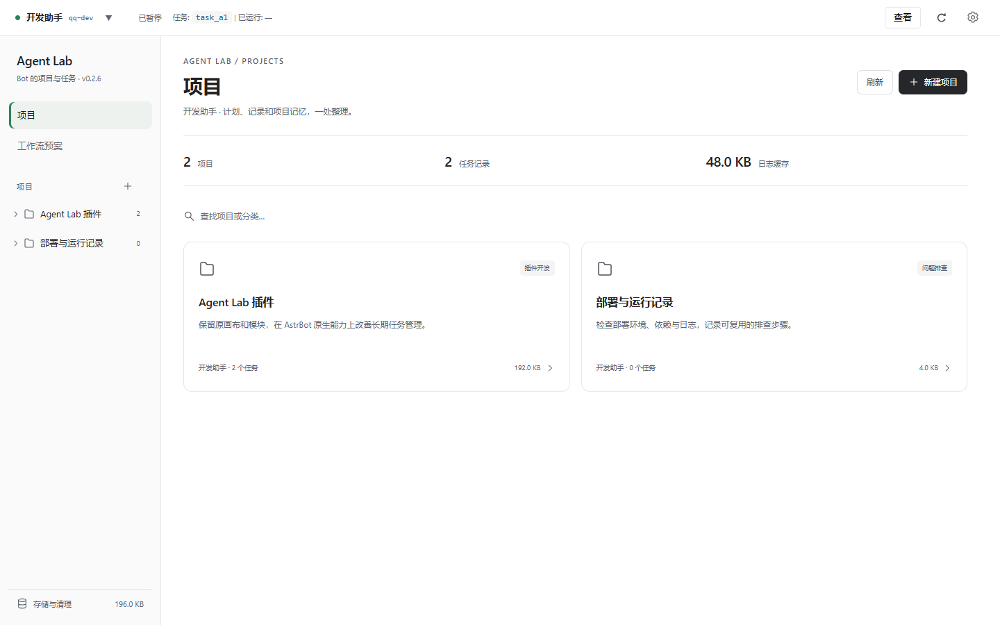

# Agent Lab

让 AstrBot 的 Bot 按项目管理长任务：立项、审批计划、保存检查点、途中引导、交付归档。任务记录与日常聊天分开，按需交换有限摘要。主任务沿用来源 Bot 的模型和 Persona。

## v0.2.6

本版继续保留原全屏画布与模块内核，补齐任务消息线、真实机器人筛选和工作流能力同步。

- 只显示 AstrBot 设置中已启用且当前加载的实例；单击切换，双击或“设为默认”保存，重新打开从服务端恢复。
- 进展、反问、审批、交付共用一个任务消息线。进展简报可按机器人开启，按执行事件去重限频；完整工具日志仍在项目记录。
- 画布素材和端口从后端执行器能力表同步，已停用的定时/心跳素材不再出现；连线保留原画布位置，使用圆角正交路径和有界避障。
- **黑白灰主体，绿色点缀**：项目、预案和设置共用完整内容宽度，页面切换不再反复播放位移动画，旧集成页面与节点按钮统一字体和样式。
- **清晰的侧栏**：项目树直接打开任务；齿轮内集中机器人身份、插件与集成；存储与清理固定在侧栏底部。
- **工作流预案**：原“全部方案”改为精简预案库，管理用途与流程。预案指导某类任务，具体计划与进度属于项目下的任务。Bot 可选择合适预案，也可略过。
- **多机器人**：以 AstrBot 平台实例 ID 区分 Bot。同为 QQ 的两个实例不会混为一个。左上角显示查看范围或当前项目身份；设置中的切换只过滤工作台，不改变运行中的任务来源。
- **原画布布局**：保留原右侧竖工具栏、素材窗的位置尺寸与收起入口，撤下上版新增的换边/拉宽控件。初始缩放仍为72%；窄窗口的素材内容避开换行顶栏。连线采用 XYFlow 的圆角路径和预览曲线，支持靠近端口吸附。

本轮运行了真实 Edge 浏览器交互与截图检查、真实后端模块的临时文件/Quart接口测试；没有接入生产 AstrBot 或真实模型账号。详见 [交付报告](docs/RELEASE_REPORT_v0.2.6.md) · [测试、评分与资源报告](docs/VALIDATION_v0.2.6.md) · [更新记录](CHANGELOG.md)。



## 使用方式

在 AstrBot 插件管理中安装，或将仓库克隆到插件目录：

```bash
git clone https://github.com/zzz27578/astrbot_plugin_agent_lab.git data/plugins/astrbot_plugin_agent_lab
```

适配基准为 **AstrBot 4.29.4，版本范围 >=4.29.4,<5**。默认仅管理员私聊可用；管理员来自 AstrBot `admins_id` 与插件 `workflow_admin_ids`。`private_only=true` 时关闭群聊任务入口。

对 Bot 说明目标，例如“为这个插件建项目，排查工具调用后中断的问题”。Bot 用 `agent_lab_project` 创建/选择/分类项目，用 `agent_lab_enter_mode` 立项；管理员批准具体计划后推进。也可以直接输入：

```text
/al start 排查这个插件的工具调用中断问题
```

| 命令 | 作用 |
| --- | --- |
| `/al status` | 查看当前任务 |
| `/al project` | 查看项目目录 |
| `/al approve <审批ID>` / `/al reject <审批ID>` | 批准或拒绝操作 |
| `/al steer <要求>` | 途中修改方向 |
| `/al answer <问题ID> <回答>` | 回答 Bot 的结构化反问 |
| `/al pause` / `/al resume` | 暂停或从检查点恢复 |
| `/al switch <任务ID>` | 切换同一来源的任务，先保持暂停 |
| `/al finish <说明>` | 管理员按现状交付，不受未完成步骤阻挡 |
| `/al cancel <原因>` | 管理员停止并归档 |
| `/al webui` | 查看控制台入口 |

完整前缀 `/agentlab` 同样可用。管理员结束指令优先于模型验收；未完成和未验证内容保留在交付说明中。停止不会撤销已经发生的外部操作。

## 页面与机器人身份

在 AstrBot Dashboard 的插件详情中打开 `agent-lab` 自定义页面。前端通过 AstrBotPluginPage bridge 调用后端，无需 iframe Cookie 或额外端口。

左上角显示当前机器人实例。点击旁边箭头或右上角齿轮，只能选择 AstrBot 设置中已启用且已加载的实例；单击切换查看范围，双击或点击“设为默认”保存下次进入的实例。实例停用/移除后会回退到可用实例；没有实际实例就不提供虚构选项。历史记录保留，显示切换不能把任务移给另一台 Bot。

在“设置 → 任务消息”按机器人开启进展简报并设置最短间隔。Bot 可调用 `agent_lab_progress` 说明发现与下一步；进展、结构化反问、审批和交付共享任务 ID、原管理员私聊来源及任务详情时间线。必要控制消息不受进展开关影响。该主动消息线目前仅面向原管理员私聊，真实平台投递能力由 AstrBot 适配器决定。

独立控制台为可选入口，默认 `http://127.0.0.1:8788`。配置项为 `standalone_webui_enabled`、`standalone_webui_host`、`standalone_webui_port`、`standalone_webui_token`。非本机监听必须设置 Token；原生页面使用 Dashboard 登录。两个入口共用静态资源与受认证接口。

## 预案与具体任务的区别

预案保存可复用流程，项目保存同类工作的摘要，任务保存本次目标、批准计划、步骤进展、问题和工具证据。

Bot 通过 `agent_lab_workflow_catalog` 按标题和简介选择流程：`workflow_mode="none"` 跳过画布；`workflow_mode="selected"` 配合 `agent_id` 应用指定预案。无合适预案不阻碍立项。原模块、条件/循环、并行、子代理、API与凭证配置继续可用。

长任务由执行事件续接，不靠前端心跳。自动续接受计划审批、操作权限、未知工具结果、无进展和预算约束；重启后保留检查点，未知外部动作不直接重放。

## 记录、摘要与清理

- 任务使用独立原生 conversation，不切换日常聊天的当前会话，也不把全部工具输出注入日常。
- 立项只接收显式交接摘要。任务读取同项目最多3500字交接；日常自动互通需明确开启，最多800字。
- 项目索引和摘要为插件数据目录 `projects/` 下的 JSON/Markdown。项目页可查看任务记录与相对路径。
- 侧栏显示记录文件大小；清理预览另列原生任务对话内容大小。内容字节数不等于 SQLite 数据库能立即释放的物理空间。
- 清理必须预览并确认，预览后数据变化会拒绝旧确认。缓存清理保留计划和摘要；历史/项目删除处理对应记录、记忆与任务对话，不删除开发源码目录。

更多任务内核设计见 [v0.2.4 交付报告](docs/RELEASE_REPORT_v0.2.4.md)。旧版本的界面、配色、心跳入口说明以当前 README 为准。

## 开发与验证

安装插件不需要 Node、Playwright 或构建步骤；提交的前端资源直接使用。开发检查方法见 [scripts/ui/README.md](scripts/ui/README.md)。

```bash
python scripts/static_review.py
python scripts/ui/test_project_runtime.py
```

许可证见 [LICENSE](LICENSE)。本地连线路径包使用 XYFlow 的 MIT 许可代码，详见 [第三方说明](pages/agent-lab/vendor/README.md)。
