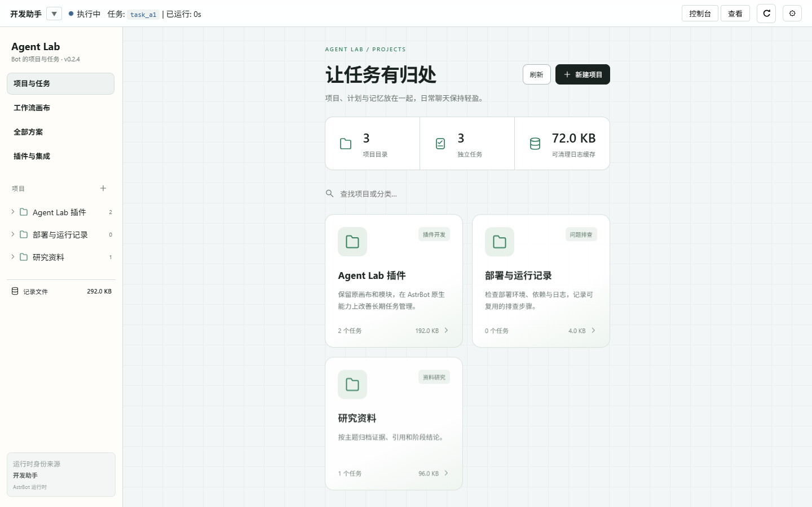
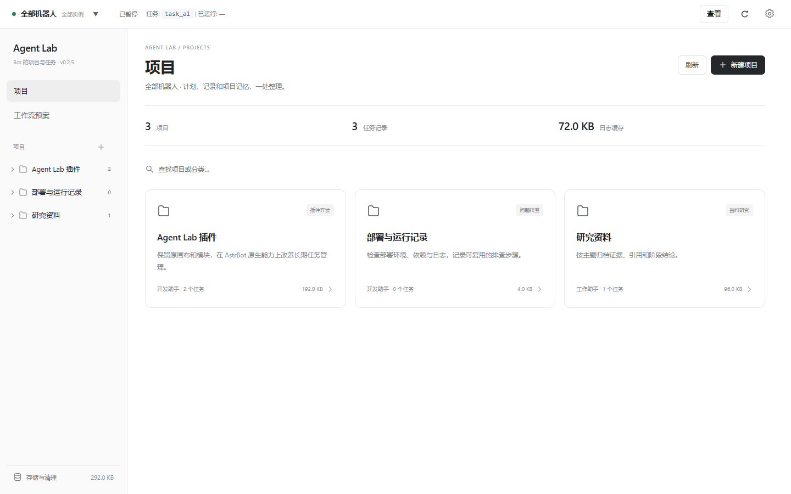
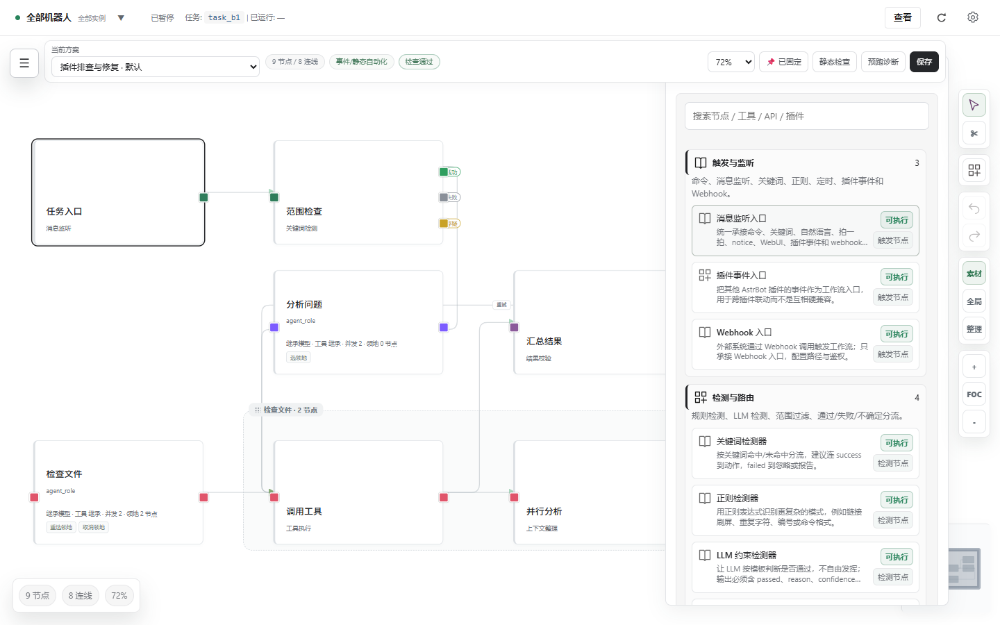
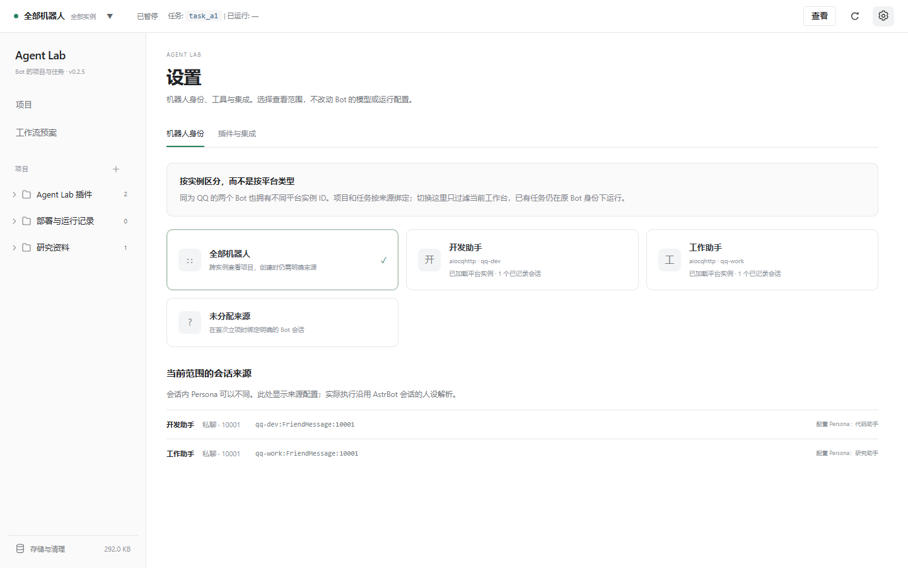

# v0.2.5 交付报告

日期：2026-11-11。基于 v0.2.4 增量修改。主要适配基准仍为 AstrBot 4.29.4。

## 改了什么

这次把工作台收束为“项目、工作流预案、设置”。项目管具体工作和记录，预案管可复用流程，设置管机器人查看范围与集成。Bot 继续使用 AstrBot 已配置的模型和工具。

| 用户指出的问题 | 本次处理 |
| --- | --- |
| 越来越绿、页面冗杂 | 黑白灰占主体，绿只用于状态/选择点缀；去掉大面积绿色卡片和重复身份区。危险操作、端口类别仍保留小面积语义颜色 |
| 首页不对齐，切页忽宽忽窄、弹跳 | 用统一壳层网格和内容边距，取消页面宽度上限与根节点重复入场动画；固定滚动条占位 |
| 设置和侧栏分散 | 插件与集成放入齿轮设置；身份查看范围也在这里；存储固定在侧栏底部 |
| “全部方案”与项目概念混乱 | 改成精简“工作流预案”：名称、简洁用途、节点数、编辑/复制/删除。取消原方案页重复的项目运行概览与手动任务入口 |
| 不知道是哪台 Bot | 显示平台实例名称与精确 ID；项目卡片标明来源，选中项目后左上角身份和状态对应同一项目 |
| 不要再移画布按钮和素材窗 | 恢复原竖工具栏与素材窗的位置、尺寸、收起入口，删除上版的换边/拖宽控件与事件代码 |
| 连线难看、难接 | 使用 XYFlow 圆角路径与贝塞尔预览，细化线宽/选中态，增加15px端口吸附范围，保留原手工线路提示 |
| 旧页面与新页面风格不一 | 统一集成页、素材、节点内部按钮、输入框、焦点、字号和边框；图标改为本地 SVG |

画布仍是原来的全屏画布，初次缩放72%。1440×900下实测：工具栏 `right=14px, top=76px`，素材窗 `right=74px, width=408px, height=792px`。保留原外部位置，只在窄窗口顶栏换行时给素材内部滚动区留出遮挡空间，保证搜索框可点击。

抽屉关闭原来强行覆盖整个 transform，会让居中的窗口先跳位再消失；现在只淡出。项目树和按钮保留短过渡，页面切换不再整体上下位移。支持系统“减少动态效果”。

## 多机器人怎么处理

AstrBot 的平台类型（例如 aiocqhttp）不能唯一标识机器人。本版使用 `platform.meta().id`，再结合来源 UMO（实例 ID、消息类型、会话目标）绑定项目和任务。

1. 后端只返回实例 ID、显示名称、平台类型、状态和已记录会话。平台配置中的密钥、Token、错误堆栈不投影到身份页面。
2. 设置可以查看全部实例、具体实例或未绑定项目；历史实例当前未加载会明确标记。
3. 新项目可先指定实例，首次任务再绑定具体会话。后端拒绝实例和 UMO 不匹配，也拒绝将任务移入另一台 Bot 的项目。
4. 切换查看范围不改变运行中的任务、管理员权限、模型或 Persona。会话列表的 Persona 仅标为“配置 Persona”，不冒充运行时解析后的最终人设。
5. 老项目没有 `platform_id` 时从已有 `source_umo` 推导，不要求清空历史或重建项目。

最后一次审查还修复了“左上角已经显示 B，但顶部任务仍来自 A”的问题。“查看”现在直接定位显示中的那个任务；删除了与它重复的“控制台”按钮。

## 预案怎样让 Bot 更好用

预案是“什么工作可以按什么流程做”，具体任务计划是“这一次批准做哪些步骤”。两者独立。

例如“插件排查与修复”预案简介说明检查兼容接口、修复、验证；Bot 通过已有的 `agent_lab_workflow_catalog` 读取名称和简介，合适时选择，否则 `workflow_mode=none` 直接按批准计划推进。项目可关联常用预案，复用时不用复制整份历史任务。

本版没有重写原任务内核：计划、检查点、审批、途中引导、结构化反问、任务独立会话、有限摘要与管理员结束优先沿用 v0.2.4。此次用真实后端模块验证了管理员结束不被未完成计划阻挡、晚到保存不会复活任务、同项目摘要边界和受管清理范围。

## 后端与代码整理

- 新增 `identities.py`，集中处理来源实例提取与安全显示字段；身份逻辑没有散落进任务执行器。
- `Projects` 增加项目实例绑定与跨实例校验；目录统计复用已读项目索引，同来源活动任务只加载一次，减少重复文件读取。
- `WorkspaceAPI` 集中验证创建来源并返回身份目录；保持现有认证装饰器和明确动作接口。
- `navigation.js` 管预案库与设置，`project-ui.js` 管项目页，`theme.css` 统一视觉；删除无调用的旧方案页、旧设置页及素材拖宽代码。
- XYFlow 只负责路径计算；不把 React/Svelte 或另一套 Agent 框架塞进插件。构建产物随插件分发，第三方版本锁定，MIT许可证随包保留。
- 补齐独立控制台新文件的路由，并通过 Quart 实际请求验证所有前端入口依赖可返回。

这是一轮有边界的拆分，不代表历史大文件已经完全消失：`app.js` 仍约575KB，包含原画布、模块检查器和旧详情组件。后续适合按画布坐标/连线、模块检查器、任务详情分别拆出，并沿用本轮交互回归。现在直接换掉整个画布，会再次破坏已调整好的模块与布局。

## 消耗与等待时间

项目后台刷新从5秒改为10秒。项目页静默刷新只请求目录；数据没变不重绘，正在编辑或有弹窗时跳过。侧栏滚动位置在重绘时保留。普通连线使用小型路径算法，用户手工指定线路时才走原线路提示逻辑；去掉常驻的流动箭头计算。

路径包从初始构建的48,425字节裁到 **4,268字节**（离线gzip估算1,902字节），裁掉公共入口间接引入的未使用D3代码。全部入口资源合计 **768,990字节**，分别gzip后的合计 **192,083字节**；这不是服务器已经启用压缩的声明。

本机最终场景样本：首次显示项目约181ms；24次拖动事件加脚本主动等待150ms合计325ms；整组交互记录到一个104ms主线程长任务。因此可以确认场景操作正常，不声称已经证明所有机器稳定60FPS。没有进行千级任务/节点压测，磁盘扫描和历史大文件仍是后续性能重点。

这次新增的导航、身份、预案管理和目录刷新不调用模型；测试的真实模型调用为0。原有“草拟计划/摘要”和任务执行依然会消耗模型额度，本轮没有测生产Token账单。

## 验收与交付

36项浏览器交互检查、12项后端行为测试、10项静态契约检查通过；三种宽度截图无横向溢出，素材搜索框无覆盖，浏览器无未捕获异常。测试场景、评分与限制见 [验证报告](VALIDATION_v0.2.5.md)。

发布包含版本号、README、CHANGELOG、可复现脚本、许可证和实际截图。没有增加运行时前端安装步骤，也没有主动安装外部Git/回滚插件。项目文件按原格式继续读取，新增身份字段兼容老来源。

## 截图

旧版首页：

新版首页：

原画布布局与新视觉：

设置与机器人实例：

