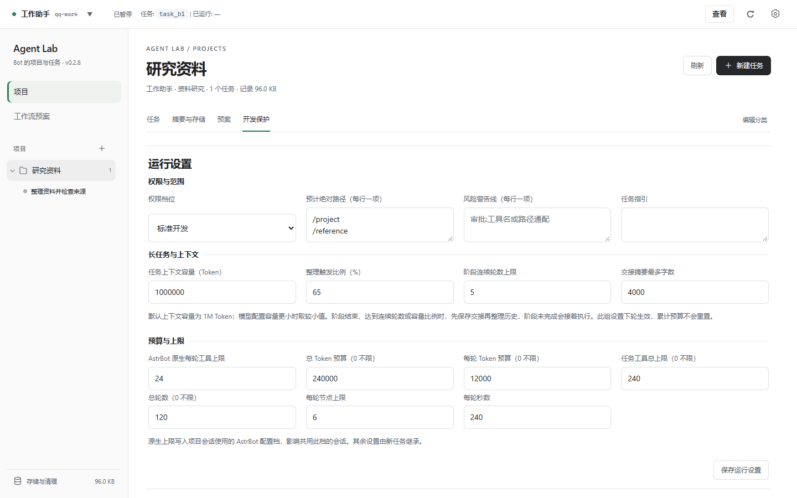

# Agent Lab / 任务模式 v0.2.8 更新报告

日期：2026-11-22。插件名称、仓库、`/al` 和 `/agentlab` 命令保持现有标识。

## 这版解决了什么

任务之前在桥接层超过40条历史后直接裁剪，任务执行器还可能再应用原生压缩/截断；仅凭清单状态无法保证继续时知道关键决定的原因。本版移除固定消息窗口，给独立任务对话接入插件的阶段交接管理器。

现在按下面的顺序继续长任务：

1. 读取当前有效计划、用户约束、当前步骤和已有证据。
2. 阶段完成、同阶段连续轮数达到上限，或上下文达到触发比例时，先保存完整原记录和步骤快照。
3. 模型分块整理中文交接，保留已确认成果、决定及原因、文件位置、验证、遗留事项与下一步。每块保存进度，跨轮时可接着整理。
4. 原记录、摘要、索引和任务状态均保存成功后，才缩减活跃历史；工具调用与对应结果始终成组处理。
5. 下轮从最新计划和交接继续，需要细节时用 `agent_lab_read_handoff` 分页回查原记录。

整理不是验收。达到轮数不会把阶段标为完成；未完成阶段接着做。摘要失败、写盘失败、工具结果不完整时保留历史；交接失败会暂停任务并说明原因。总结期间收到暂停、结束、切换或新引导时，旧总结不会覆盖最新控制状态。

## 开发保护中的设置

设置直接放在项目「开发保护 → 运行设置 → 长任务与上下文」，无需打开画布或独立按钮页面。

| 设置 | 默认 | 可设置范围 | 含义 |
| --- | --- | --- | --- |
| 任务上下文容量 | 1,000,000 Token | 2,000–10,000,000 | 模型配置了更小容量时取较小值 |
| 整理触发比例 | 70% | 30–90% | 历史、固定提示和工具定义接近容量时整理 |
| 阶段连续轮数上限 | 8轮 | 1–1000轮 | 同阶段续跑达到上限后，下一轮先整理再继续 |
| 交接摘要最多字数 | 6000字 | 1000–20000字 | 较小模型会进一步缩短摘要，给输入和输出留空间 |

连续轮数指任务续跑轮次，不是固定对话条数，也不是单次工具调用数。阶段可包含多个步骤，用相同 `stage` 名称归组；未填时每个步骤分别处理。阶段边界后结束当前轮，下一轮重载计划；会清除上一轮的停止标记。

上下文容量、每轮 Token 预算、任务累计预算各自生效。1M 设置不扩大真实模型容量，也不自动提高或重置原有任务预算；交接模型调用同样计入用量。原生工具上限继续读取和写入项目来源会话实际使用的 AstrBot 配置档。

截图为浏览器测试修改后保存的示例值；默认值以上表为准。

## 清单可以怎样调整

| 修改 | 处理 |
| --- | --- |
| 拆分步骤、重排、补排查或测试，保留原目标的返工 | 独立模型审阅实际前后差异后，确认普通调整则记录并继续 |
| 改目标、验收条件、预算、解除用户约束 | 暂停并提交计划审批，通过后应用对应变化 |
| 无法可靠判断是否普通调整 | 提交审批，由管理员核对 |
| 改写已完成步骤 | 必须提供 `reopen_reason`，保存旧记录，清空当前证据并要求新验证 |
| 删除已完成步骤 | 拒绝，保留成果记录 |
| 通过计划修改权限配置 | 拒绝，权限由管理员在项目设置中调整 |

普通调整不增加操作权限，不重置累计用量；未改变的步骤保留原摘要和证据，避免每次修订丢失进展。返工后旧工具证据不能冒充新验证。待审批或结果未知的操作处理前不允许改计划绕开它们。审阅期间管理员的新状态优先。

## 界面与互通

运行设置已放入「开发保护」页内。项目「摘要与存储」分别开放日常聊天、同项目任务的摘要互通开关和字数设置，修改自动保存。旧默认保留：日常聊天默认关闭、启用时800字；同项目任务默认开启、3500字。

项目摘要是跨任务引用的有限背景；阶段交接是当前长任务的执行记忆，两者分别管理。任务详情展示最近阶段交接，完整记录放在当前任务记忆目录 `handoffs/`；计划修订放在 `plans/`。

## 验证记录

| 检查 | 结果 |
| --- | --- |
| `python scripts/ui/test_task_continuity.py` | 16项：阶段交接、容量、分块恢复、失败保留、计划修改、返工与控制状态；含真实插件工具注册及本机 AstrBot 原生执行器的两轮阶段接续 |
| `python scripts/ui/test_project_runtime.py` | 21项：项目、权限批次、消息、清理、原生工具上限及新设置持久化 |
| `node scripts/ui/interactions.mjs` | 68项浏览器交互，含1M默认值、设置保存和重开 |
| `node scripts/ui/routing-check.mjs` | 6种连线场景、30项断言 |
| `node scripts/ui/browser-check.mjs` | 1440/1100/820宽度下无检测到的页面溢出或素材搜索遮挡 |
| `python scripts/smoke_test.py` | 通过 |
| `python scripts/static_review.py` | 36个Python文件解析、接口与版本检查；10/10源码契约断言 |
| `git diff --check` | 通过 |

另运行了旧的 `scripts/runtime_smoke_test.py`：它先发现新工具参数文档的 `integer` 不被本机 AstrBot 注册器接受，已改为支持的 `number` 并保留整数校验，真实插件导入纳入阶段测试。旧脚本随后停在自身 `FakeEvent` 缺少 `get_extra` 的过时夹具上，因此不计为通过；不能用它声称整个生产插件端到端验证完成。

上述模拟使用临时存储、模拟会话数据库和确定性模型响应，没有调用生产模型、接入真实聊天平台或修改生产任务。接口兼容覆盖本机 `context_manager` 与参考新版的 `request_context_manager`；仅本机版本执行了真实原生执行器测试。未进行长时间生产负载测试。

## 升级与边界

旧项目缺少新字段时自动使用表中的默认值，已有任务在下一轮读取项目的最新交接设置。不迁移或重写既有任务对话；在原任务上继续，不改变日常聊天的当前会话。服务重载后仍沿用既有暂停恢复规则，需要确认检查点后输入「任务继续」。

摘要仍可能遗漏信息，因此当前计划、原记录与执行证据保留为可核对依据。没有已配置模型容量或用量信息时，只能使用插件配置容量、保守长度估算和已有预算反馈；1M 不能代替模型供应商的实际上下文限制。完整交接记录会占用磁盘，沿用项目既有的存储查看和清理入口。
