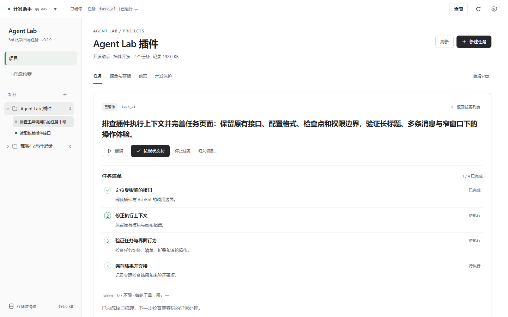
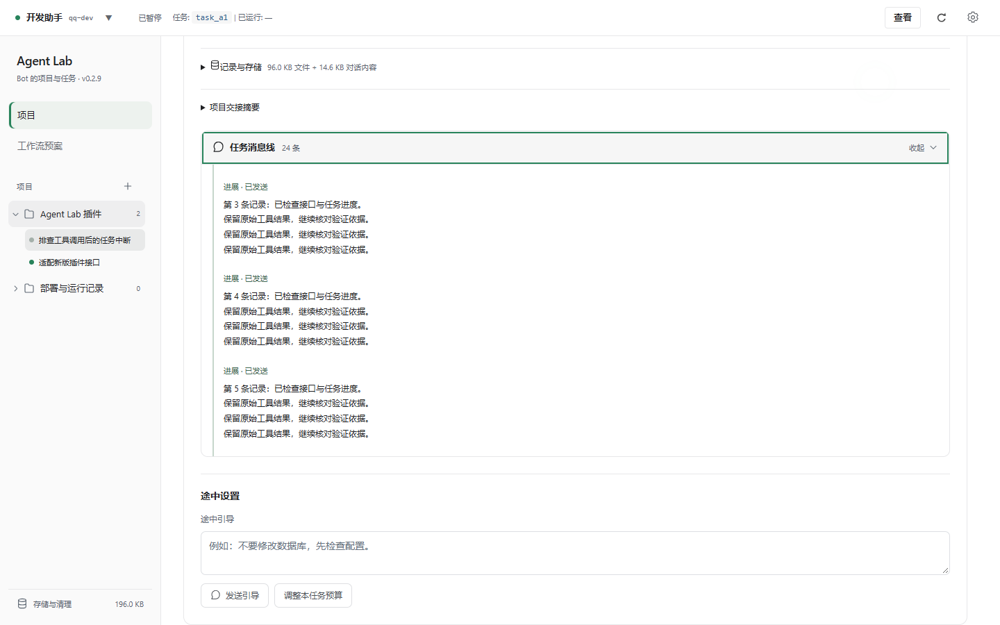
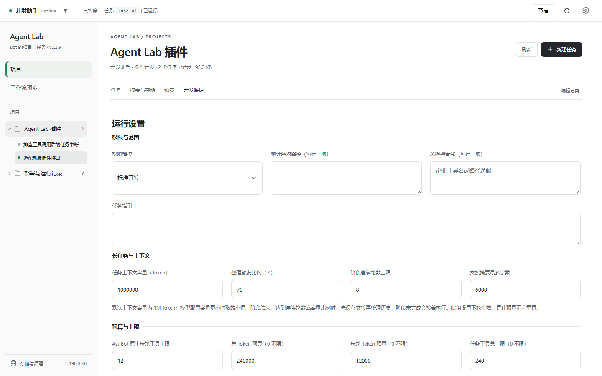

# Agent Lab / 任务模式 v0.2.9 更新报告

日期：2026-11-22。

## 任务页面

选中任务后，详情占满项目内容区。删除与左侧项目树重复的任务选择列，详情顶部保留「返回任务列表」，可以查看完整列表并打开其他任务。

任务清单放在详情主要操作之后，优先显示完成数量、步骤编号与状态。已完成步骤显示勾选，不再因旧的当前步骤标记被突出。

任务消息线放在清单、交接与记录区域下方。消息框最大高度为420px或窗口高度的55%，支持框内滚轮、键盘展开/收起；任务刷新保留展开状态和阅读位置。页面展示接口返回的全部消息，不再额外截成最近8条；后端原有消息保留上限仍然生效。

「途中引导」与「调整本任务预算」集中在消息线下方的「途中设置」。预算入口继续只在选中且暂停的任务显示，结束的任务不显示途中设置。

## 开发保护表单

权限档位选择框、预计路径和风险警告线采用相同列宽、高度80px，顶边与底边对齐。任务指引独占整行，数字输入框统一44px高；保存按钮使用统一的主按钮样式与勾选图标。

桌面权限区为三列，中等窗口为两列，小窗口为一列。保留现有黑白灰与绿色点缀，以及原生下拉框的键盘操作。

## 验证

| 检查 | 结果 |
| --- | --- |
| `node scripts/ui/interactions.mjs` | 68项通过，浏览器异常0项 |
| `node scripts/ui/task-layout-check.mjs` | 79项通过，覆盖1440/1100/820/390四种宽度，浏览器异常0项 |
| `node scripts/ui/routing-check.mjs` | 6种场景、30项断言通过 |
| `node scripts/ui/browser-check.mjs` | 三种宽度下的预案、设置与画布无检测到的页面溢出或素材搜索遮挡，浏览器异常0项 |
| `node --check pages/agent-lab/project-ui.js` | 通过 |
| `python scripts/static_review.py` | 36个Python文件解析、接口与版本检查通过；10/10源码契约断言通过 |
| `python scripts/smoke_test.py` | 通过 |
| `git diff --check` | 通过 |

截图与[布局检查结果](screenshots/v0.2.9/layout-results.json)随本报告保存。浏览器检查运行真实Edge与沙箱iframe，使用模拟API、任务和消息，不代表生产AstrBot与真实模型联调完成；本版主要修改前端布局与交互，没有修改后端权限、预算同步或阶段交接规则。

版本号与前端修改资源的缓存标识已同步更新。安装更新后重新打开插件页面即可加载本版界面。
