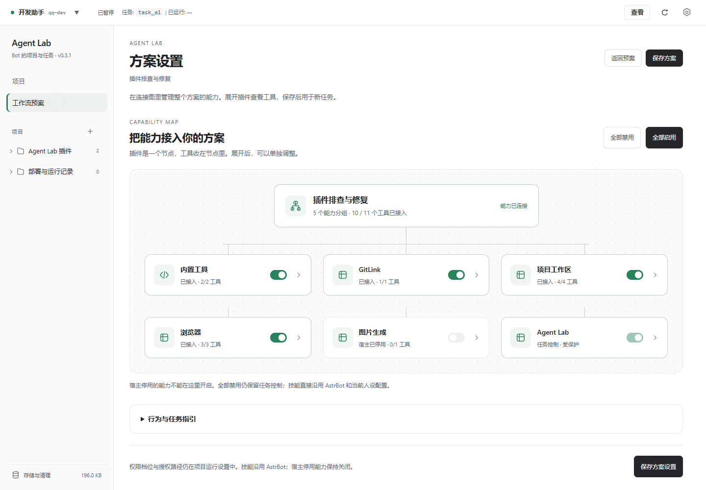
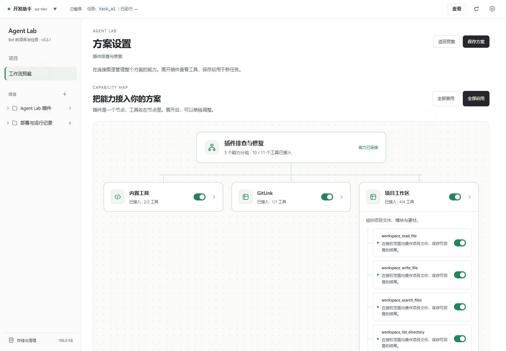

# Agent Lab v0.3.1 更新报告

2026-11-23。基于小莫的实际反馈，调整方案设置、收尾核验、通知口吻与任务上下文开销。

## 方案设置

独立设置页使用完整内容宽度，以“方案 → 插件/内置能力 → 工具”呈现连接图。插件节点可展开，工具位于节点内部，支持单工具、整组及全部启用/禁用。较长工具组在节点内滚动，避免一个插件把其余设置挤到很远。预案列表与画布均保留“方案设置”直接入口。

工具禁用保存为 `AgentSpec.disabled_tools`，在工具暴露及执行边界都生效，完全权限也不能重新放开；宿主停用的插件/工具不可在此启用，任务控制始终保留。移除单独的技能勾选，任务直接读取 AstrBot 活跃技能、宿主插件过滤和当前人设的技能选择。

## 收尾与审批记录

完成核验检查批准计划的全部步骤：每步必须完成、有结果说明，引用的工具证据必须成功，且对应当前步骤、修订和授权版本。存在未完成、失败、旧版本或未知操作仍需补齐。交接摘要进入辅助证据文本；摘要中的“全部通过”不能替代真实工具记录。

结构化步骤已经具备有效证据时，不再要求最终总结逐字出现中文验收条件；缺少证据会返回 AI 读记录或补测，聊天收尾和画布归档均不自动生成“强制结束审批”。管理员仍可随时按现状交付。

归档保留批准事实：已应用的计划/收尾授权标为 `consumed` 并记录 `decision=approved`；批准但未执行的动作记录取消原因，不把取消当作从未批准。未批准项到任务结束才作废。已归档的旧记录不回写或伪造历史。

## 人设与上下文开销

- 执行提示词注入来源 Bot 的实际人设正文，而非只写角色名字。审批摘要使用同一人设，允许自然称呼和口吻；动作、影响与恢复信息仍须清楚。AI 给出的交付正文直接保留，不再携带整份任务日志做第二次改写。
- 新增任务单轮工具上限，默认24，与 AstrBot 原生上限取较小值；可在项目运行设置修改，下轮生效，不改宿主全局上限。达到上限后标记交接，继续原计划。
- 同一轮、无中间写入的同参数只读查询复用已有结果；失败或未知结果不复用为成功，任何非只读调用会终止复用窗口。提示大文件先搜索定位，再按行局部读。
- 普通只读结果最多8000字符直接送模型，其余外部工具最多12000字符；完整脱敏输出仍保存，可按证据ID分页读回。续轮提示词使用有限证据窗口，带参数、长度和分页标记，避免无提示丢失结果。
- 没有 `stage` 的小步骤共用一个执行阶段，仍保存检查点但不逐步额外总结清场。明确阶段结束、阶段轮数/上下文容量/工具上限继续触发先留原记录再交接。

## Shell 路径修正

同一命令内 `MOD_DIR=/...; ls "$MOD_DIR"`、`export`、明确的 PowerShell变量赋值及工具 `env` 中的字面值先解析再检查范围。`find` 区分目标路径与查询表达式，普通只读查询不因工具名误判。

来源不明、动态计算等无法静态解析的路径返回修正提示：不执行、不发审批、不累计危险拒绝；它仍受工具/时间/Token预算限制。实际越界、清空和高危破坏继续走原来的主动申请与三次兜底拒绝保护。这里是已知形式的执行前检查，不新增或声称提供操作系统沙箱。

## 验证

- 32项定向Python测试：11项新回归、8项完全权限保护，以及13项消息、设置、归档、阶段交接和真实AstrBot runner适配检查。模型与工具使用确定性响应及临时任务，未访问生产任务。
- 图形化开关状态测试：整组/单项/全部操作、保存回读及宿主停用保护。
- 1440、1100、390三种宽度各10项界面检查：从预案进入、占满内容宽度、展开工具、开关保存与回读、全部操作及无横向溢出；浏览器异常0项。结果见 [界面检查记录](screenshots/v0.3.1/results.json)。
- Python源码/接口/版本契约、修改的JavaScript语法、独立服务静态资源及核心冒烟检查通过。

未跑真实 Bot / 模型体验测试，不承诺具体Token节省比例。小莫反馈的生产调用次数和Token数来自用户提供，未读取对应原始任务归档独立核对。

版本、前端缓存标识、任务内置技能和更新日志同步升级。
