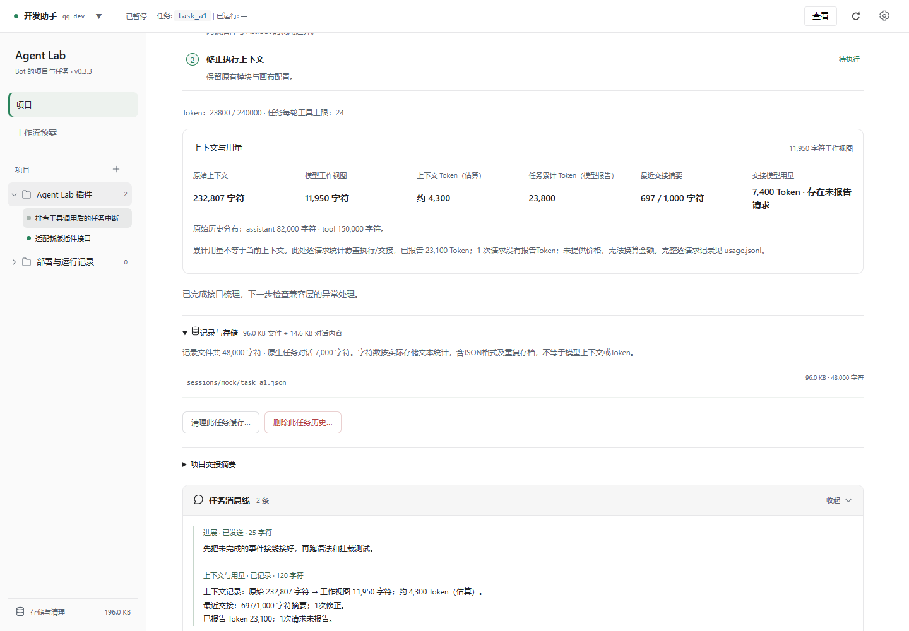

# Agent Lab v0.3.3：上下文自查、可见用量与极端模拟

2026-11-23。此版继续针对小莫反馈的“同样消息条数、上下文翻倍”自查，而不是仅调小摘要上限。

## 自查发现与处理

1. **交接后仍可能把旧大历史带回来。** v0.3.2 保留最近工具组的预算按上下文容量的六分之一计算；1M容量下可能允许约11.6万估算Token，再度带回大量签名与代码。极端测试第一次就抓到：交接后还剩297,510字符。现将保留最近组的预算封顶到约4k估算Token，活跃工作历史达到约24k估算Token就提前交接，不等待1M的70%。同一测试现为1,115字符，并验证紧接着再处理一次不会立刻再次交接。
2. **文件被外部删除后，同轮无版本缓存可能回旧内容。** 文件读取不再落入普通同轮缓存兜底；删除后得到真实不存在结果，重建或编辑后按新版本重新读取。跨轮/重叠行范围缓存仍由文件版本与宿主权限配置约束。
3. **工作视图与统计自身也要有界。** 已索引的内容不再套一层新索引；嵌套列表/字典参数也摘要化。60次反复处理后的工作视图字符数不增长；100次用量更新只保留12份轮次概要，详细记录独立到磁盘，不能重新塞进模型。
4. **中断后的游标必须对应同一份总结源。** 保存已总结前缀的哈希；恢复时如源已变化，重新汇总并保留旧进度，防止按旧字符位置跳过新内容。
5. **摘要请求没有独立超时。** 新增单次30秒超时，最多两次尝试；超时、空、超长分别记录原因、时长和字符数。仍异常时保留原文、明确降级并要求回查。外部取消/预算异常继续向上抛，不能被降级逻辑吞掉。工具写入超时仍按结果未知暂停，不能自动重放。

## 任务线与存储现在记录什么

- 每次模型请求记录原始/模型工作视图的序列化字符数、角色分布、工具描述字符数、估算上下文Token、模型返回的input/cached/output/total用量及耗时。仅保存数字，不再复制提示词、思考、签名或代码。
- 每轮和每次交接在任务线新增“上下文与用量 · 已记录”，无需新模型调用，也不额外向管理员私聊推送统计。正常审批、暂停和交付消息仍保留原通道。
- 最近交接记录原历史字符数、实际总结材料字符数、摘要实际字符/上限、修正次数、质量和本次交接请求用量。请求没有报告用量时明确记为未报告，不当作0消耗或免费。
- 任务详情可展开查看统计。项目存储、每份记录文件、原生任务对话增加字符数；字符数按UTF-8文本解码后的实际存储文本计算，含JSON格式和重复存档，不能当作“当前模型上下文”。计数按文件版本缓存，避免每次刷新重扫不变文件。
- 任务累计Token和执行/交接逐请求统计分别显示；后者只覆盖启用统计后的执行/交接调用，不能冒充历史总账。没有价格配置，不伪造金额。

## 极端模拟结果

在临时目录、确定性的工具和模拟供应商上执行；**没有真实模型费用，没有操作小莫的生产任务、监工台或原归档**。原始44条生产草稿并未直接作为完整输入提供，因此以下是相近结构的更大压力样本，不是生产账单重放。

| 场景 | 结果 |
| --- | --- |
| 44条消息，包含大段签名、15次代码读取及编辑参数 | 原历史437,613字符 → 总结材料11,677字符 → 交接后1,115字符；一次总结请求；下一次处理不重复交接 |
| 工作摘要长度 | 46/800字符；上限无需写满 |
| 上述交接的模拟供应商Token报告 | 7,432 Token，仅为测试中确定性供应商的模拟用量，不是实测收费 |
| 新建1617行文件、重叠读、跨轮续写、删除后重建 | 重叠0:100、70:150只补读100:150；修改/删除/重建后不使用旧缓存 |
| 归档与历史清理 | 先预览与验证令牌，错误令牌拒绝；正确清理删除任务记录，不删除源码目录 |
| 连续两次空摘要 | 两次请求后明确降级，任务继续，无自动审批 |
| 连续两次50,000字符超长摘要 | 两次请求后降级，工作摘要保持800字符以内，异常原文独立保存 |
| 超时后成功 / 连续两次摘要超时 | 各只尝试两次；分别正常继续或明确降级，记录timeout；测试将30秒缩为0.01秒以确定性触发 |
| 文件已写一部分，工具超时 | 只执行一次，记录unknown并暂停；后续调用不能自动重放 |
| 总结预算中断后续接 | 同源从上次成功段继续，不重跑首段；源前缀改变则安全重算 |
| 管理员终止后旧执行轮尝试保存 | 终止标记有效，任务不会复活 |
| 60次工作视图转换、100次用量更新 | 工作视图不增长；轮次概要最多12项；缺用量的50次请求明确标记 |

机器可读结果：[7项测试、12个场景](validation/v0.3.3-context-stress.json)。字符数和摘要长度为实际测试文本计数；Token必须按来源区分“模型报告”“模拟供应商报告”和“估算”。不以字符缩减比例承诺真实Token账单同幅下降。

## 验证

定向Python测试覆盖上述压力场景、已有上下文减负、阶段交接、真实AstrBot runner适配、完全权限与交付、消息及清理。桌面1440和窄屏390各10项统计/存储显示检查，加浏览器异常检查共21项通过。截图与[界面检查记录](screenshots/v0.3.3/results.json)随报告保存。

共47项定向Python测试通过（7项压力测试与40项减负、权限、收尾、阶段、资源和清理回归）；42个核心Python源文件解析、10项静态契约、核心冒烟与前端语法检查通过。未把旧的“无文件版本也可返回缓存”断言当作目标保留，普通查询复用和本地文件版本复用分别验证。

软件版本、前端修改资源缓存、任务技能与更新日志同步为v0.3.3。原始历史、完整证据和模型协议要求的签名保留；任意一次巨大返回或固定系统/工具提示超过容量，仍需依据可见统计处理，不承诺绕过模型自身容量限制。
