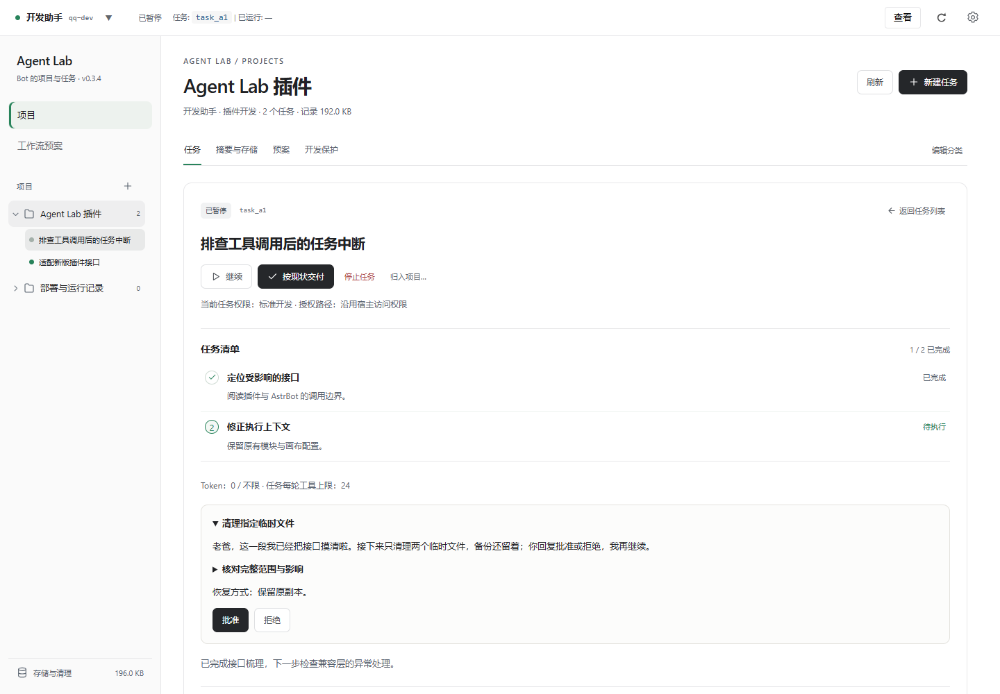

# Agent Lab v0.3.4：Bot自拟交付、低开销阶段续接与空转防护

2026-11-25。先前v0.3.3（`9e76a04`）已补推至仓库，本版在其基础上按用户授权分工模拟，再依据异常整合优化。全部量化场景使用临时文件、模拟工具和确定性供应商；未调用真实API、未动小莫任务或监工台，不以估算替代账单。

## 本版实际行为

### Bot是文案作者

- `agent_lab_request_approval(message=...)` 提交最终审批正文，计划JSON同样可带`message`；插件只加`[任务 ID · 需要审批]`标题。移除第二次模型改写、固定四段模板和自动附加的批准尾巴。Bot应在正文自行说明动作、影响、恢复和如何回应；确切工具参数继续独立保存及校验。
- `agent_lab_checkpoint(..., message=...)` 可直接交付一个阶段。`summary`保留实际成果/证据/下一步，`message`是管理员看到的角色原话；二者用途分开。`agent_lab_finish(..., message=...)`可用短文案交付并保留详细归档报告。
- `agent_lab_progress(kind=status/stage)`可提交核实后的状态说明或分段交付；日常模式也可先查短状态再按角色解释任务报错，不需暂停背景任务。
- 可在计划中预写`notifications`的paused/error/budget/stalled角色提醒，系统异常时直接发送。没有预写时只发专属标题与原因码，具体诊断在任务线；不假装Bot在未运行时自拟了详细解释。
- 外部正文不拼接、不截短。进展最多600字符，阶段/审批/交付最多2000字符；太长返回Bot自行简化，详细内容留档。老记录未提供`message`时只拼接已存字段，不新增模型请求。系统诊断与数字统计是本地记录，不当角色发言。

### 分段交接减少重复工作

此前`continuity.stage_of`虽然允许未分组共用阶段，但真实`submit_plan`仍默认每步自身ID，本版修正真实计划默认stage为`task_execution`。Bot也可明确指定develop/verify等阶段，按工作自行安排。

阶段完成时，短且具成功证据的checkpoint摘要直接作为交接正文，存下完整原历史但**不再付费调用一次总结模型**。超过工作摘要预算、上下文容量/轮数等中途触发仍走有界总结、一次修正及明确降级。总目标、约束、授权与证据仍以持久记录为准，摘要不能擅自把未验证写成完成。

规划和修订模型请求有时间上限并记录用量。修订审阅只提交步骤定义与必要约束，不再发送完整阶段报告/证据列表。初始计划、改变验收和管理员权限等原边界继续有效，不以“更流畅”为由移除授权。

### 任务和日常确实分开

- 每个task/lane使用稳定独立对话ID，来源UMO仍用于权限、模型、人设和私聊接收者；任务不创建或切换日常当前对话指针，不把完整任务历史写入日常。
- 人设解析只读取日常对话元数据的persona_id，不再让`get_conversation()`序列化大段日常history；同时校验会话归属，并用平台类型而非实例ID解析人设。
- 旧的session插件快照接口改为只读兼容，不写回日常插件偏好，避免恢复旧任务时覆盖管理员在日常新改的配置。任务工具开关继续由私有AgentSpec与执行边界过滤，宿主停用不能复活。
- 日常只得到短任务状态以及管理员明确开启的有限项目摘要。不同来源任务可并行；同来源维持一个选中任务，切换保持检查点暂停。背景模型请求不持有日常对话锁；API确实支持并发时可重叠，插件不改供应商TPM或排队策略。

### 空转、错误与超时不靠“日志变了”判断进展

新增`progress_guard`核对新成功工具意图、有效完成步骤和新完成节点。不同文件范围的真实新查询可以算进展；重复同参成功、换call ID、仅换结果文字、日志/Token上涨不算。一次真实交接可给一次grace，反复只总结历史不能一直续命。

连续2轮无进展/失败预警，3轮暂停并停止自动派发；原因码和数字进入任务线。实际未知副作用、管理员停止、待审批、预算及计划/指导版本更改优先，不被旧执行轮覆盖。明确恢复会重置该轮空转计数；全部总预算仍限制新颖但无关的工具尝试，不能把新参数当作任务已完成。

整轮deadline覆盖批准批次、确定性工作流、provider查找和模型/工具执行；等全局并发闸后重新读取任务，防止队列中的旧快照把已暂停任务恢复。SDK内部工具仍须支持协作式取消；插件不声称能强杀阻塞的原生进程。

### 缓存与协议修正

损坏索引、无效UTF-8、缺失/被改动缓存正文、假EOF、越过请求范围的工具输出均不能作为可信缓存。缓存正文用哈希校验并保留CRLF；完整命中不再重写索引。

工作视图对小输出不做更贵的索引包装，对旧证据ID按需查询；非对象工具参数不会崩溃。供应商请求保留消息、调用或function元数据中的签名；总结材料才移除思考/签名。原始历史不变。

## 实验数据与性能边界

### 三项目、12轮、120次文本读取

详见[上下文/缓存基准](validation/v0.3.4-context-benchmark.json)。项目分别为网页看板、Python服务、中文资料，每份1617行，均测创建、稀疏/重叠读取、后续轮重复、变更与损坏缓存。

| 指标 | 无缓存基线 | 当前工作路径 |
| --- | ---: | ---: |
| 实际新读工具次数 | 120 | 45 |
| 新读返回字符 | 453,592 | 189,598 |
| 末轮历史合计字符 | 528,078 | 118,657 |
| 末轮估算Token合计 | 262,596 | 51,990 |

这证明减少重复读取和输入体积，不证明真实账单降低相同比例。缓存元数据、哈希、独立证据落盘有本地开销；最后一次基准读盘基线约61ms，缓存路径约971ms，**没有证明单机文件I/O提速或真实任务更快**。潜在收益来自减少真实工具和模型输入，供应商延时/计费需小莫在线体验。

### 日常和任务同时工作

[隔离并发模拟](validation/v0.3.4-isolation-concurrency.json)运行两个独立任务和同一来源的日常跟进，共享一个模拟供应商，峰值3个请求同时在途。每次脚本延迟80ms，串行延迟基线240ms，实际重叠耗时由报告记录（含插件/磁盘开销）。日常原历史、会话指针、个性人设和后续日常轮均保留，两个项目的原文没有串入对方或日常。

这仅证明插件未把这些请求强制串行化；真实SDK锁、供应商并发/限流、网络、TPM与设备性能不在模拟中伪造结论。

### 生命周期与安全异常

[多项目场景12项](validation/v0.3.4-project-scenarios.json)覆盖资料研究不写源码、小插件创建/更新/两个指定临时文件清理、不同来源并行、同来源切换续写、真实submit_plan默认stage、checkpoint阶段交付、拒绝审批改方案、停止后晚回调、清理预览令牌和项目/原生历史变化失效。短阶段交接测试中模型调用从1次降为0次。

[空转/异常40项](validation/v0.3.4-liveness.json)模拟日志和Token伪进度、重复读取/写入、不同范围合法查询、失败/超时、审批等待、总预算上限、排队时暂停/切换、租约及心跳清理、已停止后的异常回调。预警本地记录，没有真实消息和模型收费。

此外有[75项整合回归](validation/v0.3.4-regressions.json)，含5项Bot原话/通知/交付和零总结交接检查。四组专项16+40+12+3，加75项回归，**共146项Python测试通过**；43个核心源码解析、10项静态契约、核心冒烟、前端语法及13项桌面/窄屏角色消息UI检查通过。已有统计页另有21项界面检查通过。所有测试不访问生产任务或真实模型。

## 升级与剩余限制

版本、资源缓存和内置任务技能统一升级v0.3.4。既有运行任务的服务重载仍需核对未知结果后明确继续；新方案可自由用无画布计划或选已有画布。新文案参数可选，旧调用兼容，但想完全保留角色表达应主动提供message/notifications。

初始计划批准与管理员控制继续保留；完全权限范围内普通读写和少量指定清理不新增逐项审批。已有完整记录可回查，工作视图不会被当作真实执行证据。

进展检测不是语义证明，随机新参数或只在外部变化的文件仍有保守边界；总工具/时间/Token预算不能随意取消。没有新增操作系统沙箱。真实API价格、Token账单与流畅程度留待使用者体验，不以离线测试代替。
