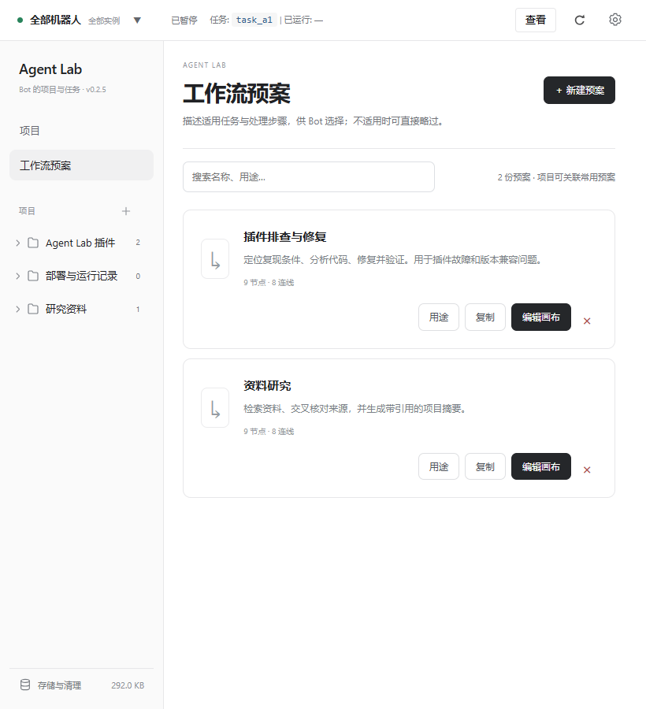
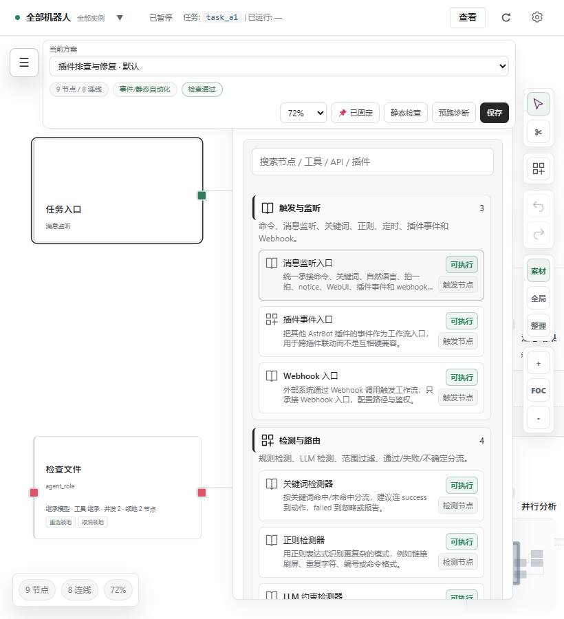

# v0.2.5 测试、评分与资源报告

日期：2026-11-11。本轮已按新授权实际运行浏览器和后端模块测试。以下“通过”仅覆盖列出的环境与场景。

## 环境与边界

- Windows，真实 Microsoft Edge Chromium（Playwright启动，无头模式），当前仓库的HTML/CSS/JavaScript。
- iframe使用 `allow-scripts allow-forms allow-downloads`，不启用 `allow-same-origin`；通过模拟父页面 postMessage bridge 调用模拟API。两个实例均为aiocqhttp，分别叫qq-dev、qq-work。
- Python 3.10，真实项目、存储、任务控制、身份、WorkspaceAPI和独立WebUI路由；临时磁盘目录、Quart测试客户端。原生会话数据库、平台对象和身份上下文为测试替身。
- 核对的 AstrBot 源码基准：4.29.4，`AstrBotDevs/AstrBot` 提交6133541。并未启动完整 AstrBot、登录真实平台或调用真实模型。Python模块测试不代表完整AstrBot运行环境验证。
- 未进行真实部署重启恢复、未知外部工具副作用恢复、大规模数据库、千级节点、触屏或所有移动端尺寸测试。

## 实际结果

| 检查 | 结果 | 可复现依据 |
| --- | --- | --- |
| 浏览器交互 | 36/36通过，无未捕获异常 | `scripts/ui/interactions.mjs`，结果JSON见下方 |
| 后端行为 | 12/12通过 | `python scripts/ui/test_project_runtime.py` |
| 页面截图/几何 | 1440、1100、820 × 900全部检查通过 | `scripts/ui/browser-check.mjs` |
| 源码契约 | 10/10通过；31个Python源码可解析 | `python scripts/static_review.py` |
| JavaScript语法 | app / project-ui / navigation通过 | `node --check` |
| CSS解析 | 三份CSS均0解析警告 | esbuild transform，loader=css |
| 路径库构建 | 成功，未包含D3运行时代码 | `npm run build` |
| Git差异空白检查 | 通过 | `git diff --check` |

[浏览器结果](screenshots/v0.2.5/interactions.json) · [尺寸结果](screenshots/v0.2.5/metrics.json) · [画布几何](screenshots/v0.2.5/canvas-geometry.json) · [资源字节数](screenshots/v0.2.5/asset-sizes.json)

浏览器覆盖：首页铺满、移除底部身份区、底部存储定位、齿轮导航、多实例筛选、新项目携带来源、清理校验token、预案用途修改/复制/删除、原画布位置、真实端口拖拽、撤销/重做、选择线并Delete、节点拖动并保存、管理员交付请求、取消清理不发删除请求、页面反复切换边界一致、项目身份与顶部任务一致、查看跳转准确、搜索跨页保持过滤、减少动态效果。

后端的12个行为测试：

1. 两个同类型实例的项目不混合，跨实例附加/选择被拒绝。
2. 尚未绑定会话但已指定实例的项目，仍拒绝其他Bot任务。
3. 身份返回字段不包含平台Token、密钥或错误堆栈；畸形历史来源不阻塞整个目录。
4. 管理员交付跳过未完成步骤和待审批，晚到保存不能复活活动任务。
5. 停止停放的旧任务，不取消同来源当前任务。
6. 项目摘要默认不向日常注入，开启后最多800字；任务摘要不跨项目。
7. 预览后数据变化，旧清理token被拒绝。
8. 缓存清理保留计划/摘要、源码文件和日常conversation，只处理任务对话。
9. 删除A实例历史，不删除B实例记录。
10. 结构化问题回答持久化，重复回答被拒绝。
11. 未认证WorkspaceAPI返回403，实例/UMO冲突返回400，正确绑定可创建。
12. 独立WebUI全部入口依赖返回200，vendor路径穿越返回404。

这些是模块级的实际运行证据。尤其是第6、8项使用模拟原生数据库，不能单独证明生产AstrBot与平台消息的端到端隔离已经验收。

## 页面边界与原画布

非画布页面统一使用如下内容区（CSS像素）：

| 宽度 | 左边界 | 上边界 | 内容宽度 |
| --- | ---: | ---: | ---: |
| 1440 | 264 | 80 | 1129 |
| 1100 | 232 | 76 | 829 |
| 820 | 232 | 76 | 549 |

项目/预案/设置切换不改变这些边界。画布继续使用独立全屏布局。1440×900实测：右侧工具栏right14/top76；素材窗right74、width408、height792；没有改成底部横工具栏。

三个宽度分别检查素材搜索输入框中心的真实命中元素，均为输入框本身。820宽度下顶栏换行，但内容不会被顶栏挡住。面板外部位置和尺寸仍由原style.css决定。

## 评分与返工记录

这是依据本轮截图与交互证据的开发者自评，不是用户盲测，也不冒充设计比赛评分。门槛为每个审美项至少8.5；发现功能失败则该项按0处理并修正后重测。

初次检查仍有集成页绿色边框过多、窄预案行拥挤、旧节点按钮样式、窄画布搜索遮挡，均进行了修正。顶部任务身份错配、查看不定位、跨页搜索结果失配也已修复，并补入交互回归。未将这些失败保留为“已完成”。

| 审美维度 | 最终自评/10 | 依据与保留意见 |
| --- | ---: | --- |
| 页面对齐与密度 | 9.0 | 共用铺满边界；三种宽度无横向溢出 |
| 黑白与绿色点缀 | 8.8 | 卡片和面板为中性色；危险与端口仍用小面积语义色 |
| 字体与信息层级 | 8.5 | 旧集成与节点按钮已统一；72%画布的小字仍会偏小，可调比例 |
| 动效与稳定性 | 8.5 | 不再整页弹跳、抽屉关闭不跳位；仍需真实设备手感反馈 |
| 导航与视觉一致性 | 8.7 | 身份、集成、存储都有唯一清晰入口；保留原画布布局 |
| 等权综合 | **8.7** | 达到本轮自评门槛 |

功能完成度不采用掩盖失败的平均分：本轮已实现范围的36项浏览器检查和12项后端测试全部通过，未留下已知失败用例。生产模型/平台联调列为未验证，不能因此宣称整个插件“100%无bug”。

## 资源和耗时

路径算法库：4,268字节，离线gzip为1,902字节。初次构建48,425字节，去掉未用D3模块后减少约91%。未引入React/Svelte运行时，不依赖CDN。

9个入口静态文件合计768,990字节，逐文件离线gzip合计192,083字节（约187.6KiB）。压缩值仅用于体积比较；未验证生产HTTP压缩配置。旧app.js约575KB仍占主要份额，尚未完成全量模块拆分。

最终本机样本记录于interactions.json：

- 首次显示项目：181ms。
- 24次拖动事件及脚本主动等待150ms：325ms。
- 整组交互26次模拟API请求；1个主线程长任务，最长104ms。

这些时间包含自动化和本机环境影响，不是生产性能承诺，不能由此推导稳定60FPS。普通目录10秒刷新，无变化不重绘；没有增加轮询模型。项目目录仍扫描本地任务文件，没有做大规模历史压测。

UI导航/身份选择/存储统计/预案编辑没有新增模型调用。本次检查实际模型Token消耗为0；草拟计划、摘要与后台执行的真实生产Token消耗未测。

复现命令与测试替身说明见 [scripts/ui/README.md](../scripts/ui/README.md)。
